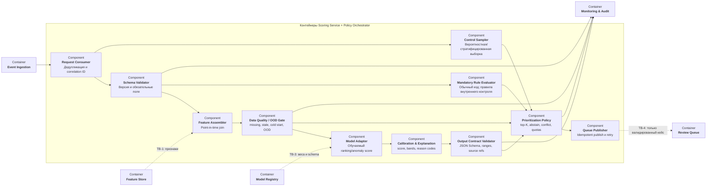

Декомпозируются контейнеры `Scoring Service` и `Policy & Queue Orchestrator`

## Порядок выполнения

1. Обычный код валидирует событие, устраняет повторы и собирает признаки
   строго на момент операции
2. Gate проверяет полноту, freshness, область применимости и наличие истории.
3. Только обучаемое звено рассчитывает ranking/anomaly score
4. Детерминированный слой калибрует контракт, выполняет обязательные правила,
   обрабатывает расхождения/воздержание и резервирует контрольную выборку
5. В очередь публикуется рекомендация на ручную проверку; бизнес-решение
   принимает специалист в Case Management

Retrieval и агентские инструменты отсутствуют: для таблично-временного
скоринга они не улучшают требуемый контракт. Текст назначения преобразуется
версионированным локальным encoder/feature extractor без внешнего поиска и без
права выполнять действия
