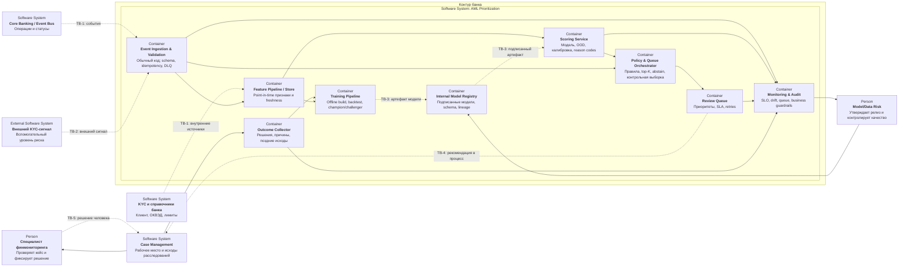

## Режим

- Скоринг асинхронный, event-driven, с семантикой at-least-once
- Идемпотентность: `(operation_id, event_version, policy_version)`
- Пилот обрабатывает операции текущей очереди; сервис не находится в
  синхронном пути проведения платежа
- При временном сбое выполняются ограниченные повторы с backoff, затем событие
  попадает в DLQ и очередь строится по действующим правилам
- Batch используется для тяжёлых агрегатов, обучения и переоценки качества;
  он не заменяет near-real-time постановку кейса

Пунктирные связи `TB-n` - границы доверия, раскрытые в [таблице угроз](operations-and-security.md#границы-доверия-aml)
