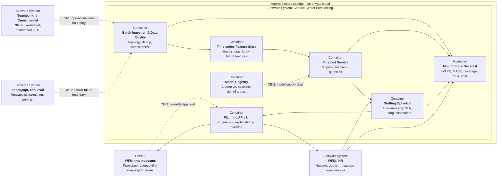

## Режим и состав

- Batch-прогноз строится на недели вперёд после закрытия интервалов; intraday
  пересчёт запускается по расписанию или событию. Результат версионируется и
  не изменяет уже утверждённую смену без подтверждения планировщика
- Модель прогнозирует только распределение calls/workload. Перевод квантиля в
  численность и допустимое расписание выполняет детерминированный оптимизатор
- Аудио, текст разговоров и идентификаторы клиентов не нужны и не поступают в
  систему. Retrieval и LLM отсутствуют
- При недоступности модели используется последний валидный прогноз с TTL, а
  затем seasonal baseline; при сбое оптимизатора планировщик получает прогноз
  и применяет текущую процедуру WFM

Границы `CB-n` раскрыты в [таблице угроз](operations-and-security.md#границы-доверия-прогноз)
