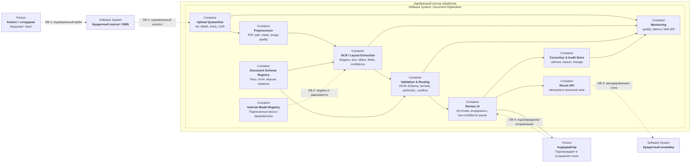

## Режим и состав

- Обработка асинхронная: пакет получает `job_id`, состояние и прогресс
  Большие документы не удерживают HTTP-соединение; шаги идемпотентны по
  хэшу файла, версии схемы и модели
- Повторы ограничены по типу ошибки; повреждённый/зашифрованный файл,
  превышение лимита и исчерпание retry направляются в ручной путь
- Контекст модели - только очищенные страницы и версия схемы документа.
  Подтверждающий источник - координаты на конкретной странице оригинала
- Инструменты - детерминированные валидаторы формата, арифметики и справочников.
  Свободного agent/tool execution и внешнего retrieval нет
- Модель извлекает; обычный код проверяет и маршрутизирует; андеррайтер
  подтверждает критичные поля. Неподтверждённые значения не участвуют в
  кредитном решении

Границы `DB-n` раскрыты в [таблице угроз](operations-and-security.md#границы-доверия-документы)
