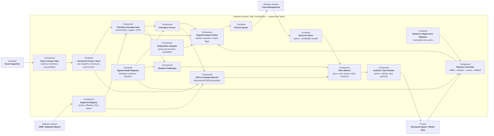

## 1. C4 Component delta

## 2. Новые обязанности

| компонент               | что добавляется ?                                                                          | почему прежней архитектуры недостаточно ?                     |
| ----------------------- | ------------------------------------------------------------------------------------------ | ------------------------------------------------------------- |
| Segment Registry        | Версия сегмента, `effective_from`, владелец, критерий присвоения и дата первого появления  | Без этого aggregate drift не связывается с бизнес-изменением  |
| Training Coverage Gate  | Для каждого сегмента: train count, temporal coverage, support/distance, OOD и cold-start   | Общий OOD может скрыть новый небольшой сегмент                |
| Versioned Feature Store | Raw snapshot/checksum и replay старой feature pipeline                                     | Позволяет отличить model drift от defect витрины              |
| Segment-aware Policy    | Новый/uncovered segment → `abstain/rule_only/manual`; отдельная calibration и feature flag | Низкий общий score не должен пропускать неизвестную область   |
| Exploration Sampler     | Минимальная квота по новым и drifting slices, inclusion probability                        | Model top-K не даёт честной обратной связи                    |
| Slice Metrics           | Метрики по segment × rule × amount band × channel × model/data version                     | Предотвращает Simpson's paradox                               |
| Dataset Registry        | Immutable core, seller pack, adversarial pack, source/time/label lineage                   | Регрессия должна быть воспроизводимой и не загрязняться train |
| Release Controller      | Атомарная версия model+features+calibration+policy; shadow/canary/rollback                 | Откат одних weights не исправит сломанный feature pipeline    |
| Alert Router            | Severity, owner, evidence, stop authority и runbook                                        | Drift без ответственного остаётся dashboard noise             |

## 3. Что мониторинг должен был поймать ?

| слой             | сигнал                                                                                            | триггер и действие                                                                                 |
| ---------------- | ------------------------------------------------------------------------------------------------- | -------------------------------------------------------------------------------------------------- |
| Бизнес-контекст  | Появился segment ID, которого нет в training manifest                                             | С первого события пометить `uncovered`; не ждать деградации label                                  |
| Состав потока    | Доля sellers, marketplace counterparties, refunds и self-employed transfers                       | Выход за pre-registered prediction band → segment review и повышенная выборка                      |
| Вход/признаки    | Amount/frequency/turnover/concentration distributions, missing/freshness, text embedding distance | OOD rate выше верхней границы train/validation либо удвоился против baseline → `abstain` для slice |
| Модель           | Score, reason codes, calibration, OOD и abstain по сегменту                                       | Сдвиг только seller slice → запрет расширения canary, shadow challenger                            |
| Очередь человека | `precision@K`, overrides, handling time, conflicts и exploration quota по сегменту                | Нижняя CI segment effect хуже non-inferiority margin или quota нарушена → rollback/freeze          |
| Бизнес           | Снятые приостановки, жалобы, time-to-review, расследования и delayed outcomes                     | Client guardrail или confirmed-yield ухудшился → stop seller model route                           |
| Сервис           | Latency, stale features, fallback, DLQ и capacity                                                 | Рост fallback/stale локализует operational cause до переобучения                                   |

Порог drift сам по себе не запускает автоматическое переобучение: он запускает
диагностику и увеличивает вероятностную выборку. Качество подтверждается
outcomes, а не расстоянием распределений

## 4. Безопасное поведение для нового сегмента

1. CRM публикует новую версию segment registry до product launch
2. Coverage Gate обнаруживает отсутствие seller examples в training manifest
3. Policy переводит sellers в `abstain`
   - mandatory rules продолжают работать
   - модель не понижает риск неизвестного сегмента
   - кейсы получают отдельную ручную/exploration quota
   - клиентское действие по-прежнему принимает сотрудник
1. После достаточной разметки seller challenger работает только shadow
2. Отдельный approval переводит его в canary; общий champion для старых
   сегментов не меняется

Так blast radius ограничен одним сегментом, а fallback не создаёт слепую зону

## 5. Хранение данных для replay

Для каждого score сохраняются:
- raw event reference и immutable checksum
- `segment_id`, версия и effective time
- feature values/reference, feature code/version и `as_of`
- model, text encoder, calibration и policy versions
- score, reason codes, OOD/abstention и route
- inclusion probability и источник выборки
- expert label, guideline version, investigation и delayed outcome раздельно

Сроки и состав хранения подтверждают DPO/юристы/комплаенс. Replay использует
минимизированные данные и те же права, что production scoring
